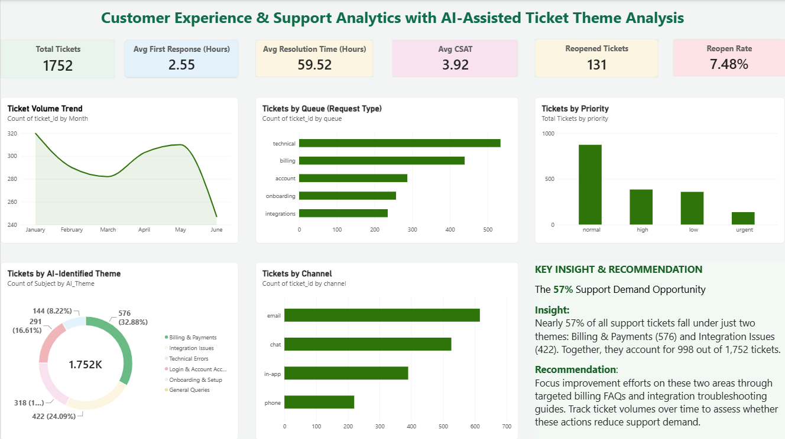

# Customer Experience & Support Analytics with AI-Assisted Ticket Theme Analysis

## Project Overview
This project analyzes customer support ticket data using Excel, Power BI, and AI-assisted ticket theme categorization to identify support trends, recurring customer issues, and opportunities to improve support operations.

## Business Problem
Customer support teams handle tickets across different channels, queues, and priority levels. Analyzing ticket volume, response time, resolution time, customer satisfaction, and recurring issue themes can help identify areas that require operational attention.

## Project Objectives
- Analyze customer support ticket volume and trends.
- Evaluate first response and resolution performance.
- Understand customer satisfaction and ticket reopening patterns.
- Categorize ticket subjects into meaningful themes with AI assistance.
- Identify major support demand areas and provide data-driven recommendations.

## Tools & Technologies
- Microsoft Excel — Data cleaning, preparation, and calculations
- Power BI — Interactive dashboard and KPI analysis
- ChatGPT — AI-assisted categorization of ticket subjects into themes

## Project Workflow
1. Reviewed and prepared the customer support ticket dataset.
2. Cleaned and organized the data using Excel.
3. Used ChatGPT to assist in categorizing ticket subjects into issue themes.
4. Integrated the categorized data into the analysis.
5. Built an interactive Power BI dashboard to analyze support KPIs and trends.
6. Identified key patterns and developed business recommendations.

## Key Performance Indicators
- Total Tickets
- Average First Response Time
- Average Resolution Time
- Average Customer Satisfaction (CSAT)
- Reopened Tickets
- Reopen Rate

## Key Insights
- Billing & Payments and Integration Issues represent approximately 57% of the tickets analyzed.
- These themes represent substantial areas of customer support demand.
- The dashboard provides visibility into ticket trends, channel performance, priority distribution, and support metrics.

## Business Recommendations
- Prioritize billing FAQs and payment-related support resources.
- Improve integration troubleshooting documentation.
- Monitor ticket trends and support KPIs to evaluate whether these initiatives reduce support demand.

## AI Contribution & Limitations
ChatGPT was used to assist with categorizing ticket subjects into meaningful themes. The categorization was reviewed and used as an analytical field in the project.

This project does not involve training a machine learning model or building an automated AI system. The theme categories represent subject-based classification and should not be interpreted as verified root causes.

## Project Files
- `customer_support_tickets.csv` — Raw dataset
- `customer_support_analytics_working.csv` — Working data
- `ticket_subject_ai_themes.xlsx` — AI-assisted theme categorization
- `customer_support_analytics.pbix` — Power BI dashboard

## Dashboard
The Power BI dashboard presents support KPIs, ticket trends, channel and priority analysis, and AI-assisted ticket themes.

## Project Purpose
This project demonstrates practical skills in data preparation, business reporting, dashboard development, KPI analysis, and AI-assisted text categorization for customer support analytics.
